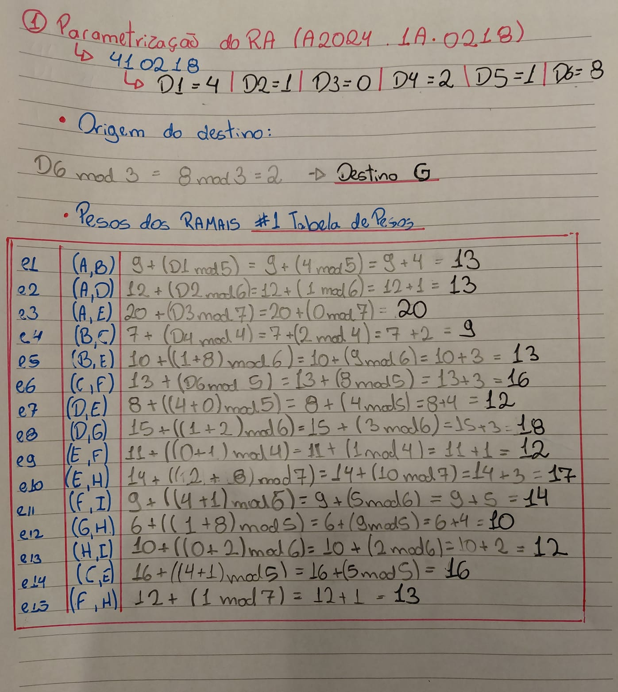
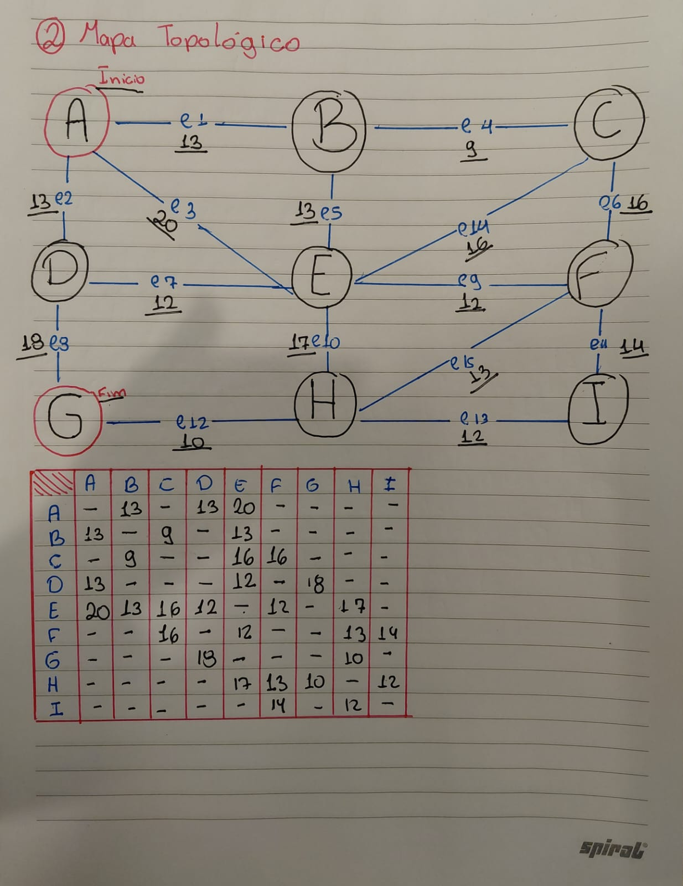
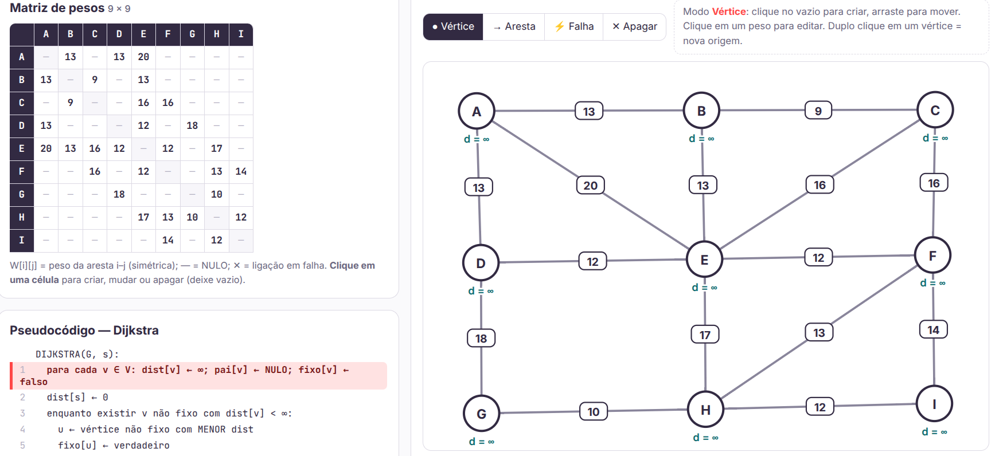

# Atividade Ponderada Smart Grid
Iniciei dando uma olhada geral nas atividades a serem feitas
## Etapa 1 — Modelagem formal e montagem da rede no simulador (2,0 pts)

1) **Tabela de pesos do RA (manuscrita):** apresente D1 a D6, o destino e os 15 pesos, mostrando a conta de cada um como na coluna de exemplo.

Realizei esse passo no papel:

2) **Diagrama topológico (manuscrito):** desenhe o grafo com os 9 vértices e as 15 arestas rotuladas com seus pesos.

3) **Matriz de pesos 9×9 (manuscrita):** indexada de A a I, simétrica (M[i][j] = M[j][i]), com — nos pares sem conexão direta e na diagonal.

Fiz também esses dois passos (2 e 3) no papel, mas acabei colocando eles na mesma folha...:\

4) **Montagem no simulador:** monte a rede e anexe o print com o desenho e a Matriz de pesos do simulador. Confira célula a célula com a sua matriz manuscrita e registre qualquer correção que tenha sido necessária, em qualquer um dos lados. 

Elas estão iguais :-)

5) **Perguntas curtas:**
* **(a) Quantas células — existem fora da diagonal principal? Por que esse número não depende do RA?**
Contando deram 21 de cada lado (são simetricas contei um lado só) 21*2 = 42. Pois o RA por enquanto serviu para contar apenas os pesose não as conexões, os - se referem a conexões que não existem depende de quais vertices estão corelacionados e da quantidade de vertices também

* **(b) Qual é o grau de cada subestação? Confirme que a soma dos graus é igual a 2|E|.**
A:3, B:3, C:3, D:3, E:6, F:4, G:2, H:4, I:2 (fiz contando a quantidade de numero na linha da matriz). 3+3+3+3+6+4+2+4+2 = 30 e 2*15 = 30 então está confirmado!

* **(c) Qual subestação tem o maior grau e o que isso indica sobre o risco operacional da rede?** A subcestação E tem maior grau com 6, não sei se entendi a segunda parte da pergunta, mas já que muitas estações estão conectadas a ela em caso de mais de uma estação falhar é possivel que muitas equipes tenham que passar pelo mesmo ponto (sinceramente não sei se entendi o que é o risco)

## Etapa 2 — Dijkstra: teste de mesa manual e confronto com o simulador (3,0 pts)

1) **Teste de mesa manuscrito:** registre, a cada iteração, o vértice fechado u, L[u], as distâncias L[v] 
de todos os vértices e os antecessores atualizados, até fechar o destino. Valores entre colchetes indicam vértices já fechados.

Realizado no papel:

Obs: na linha 2 também podeia ser D (invertido B com D) mas ia ficar muito fora da ordem alfabeticaimg/print_i.png

2) **Execução no simulador:** rode o Dijkstra passo a passo com origem A e o seu destino. Anexe dois prints: (i) o momento em que o terceiro vértice é fixado; (ii) o estado final, com a tabela “Estado dos vértices” e o caminho até o destino 

**Primeiro a (i) o momento em que o terceiro vértice é fixado:**

No simulador o D ainda não foi calculado na interação, no meu caso eu calculei antes pq a tabela pedia como o exemplo

**(ii) o estado final:**

o simulador não parou no G, ele continuou até fechar todos os vértices, eu parei quando chegou a fechar o G

No final ambos ficam A -> D -> G

3) *Registro das relaxações:* escolha a iteração k = (D4 mod 3) + 3. Para cada vizinho xaminado nessa iteração, escreva a conta dist[u] + W[u][v], compare com dist[v] e diga se houve relaxação ou se o valor foi mantido. Explique, com base na linha 6 do pseudocódigo do simulador, por que os vizinhos já fixos não são examinados. Se o destino for fechado antes da iteração k, continue a execução até ela. 