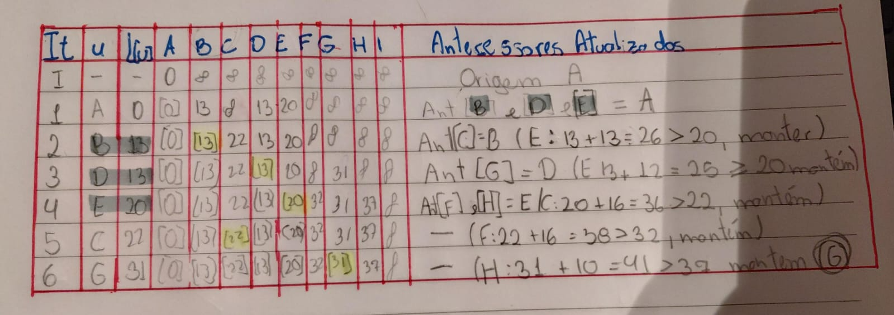
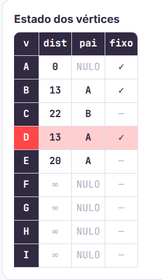
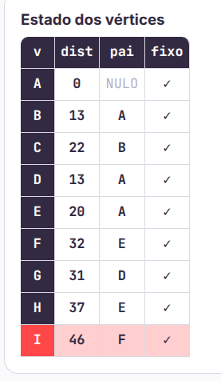
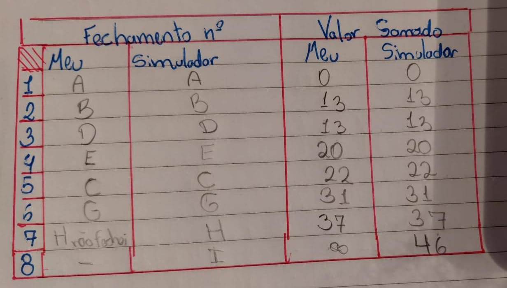
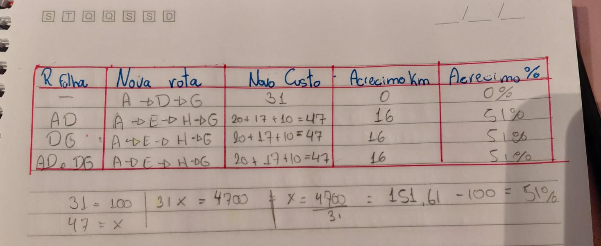
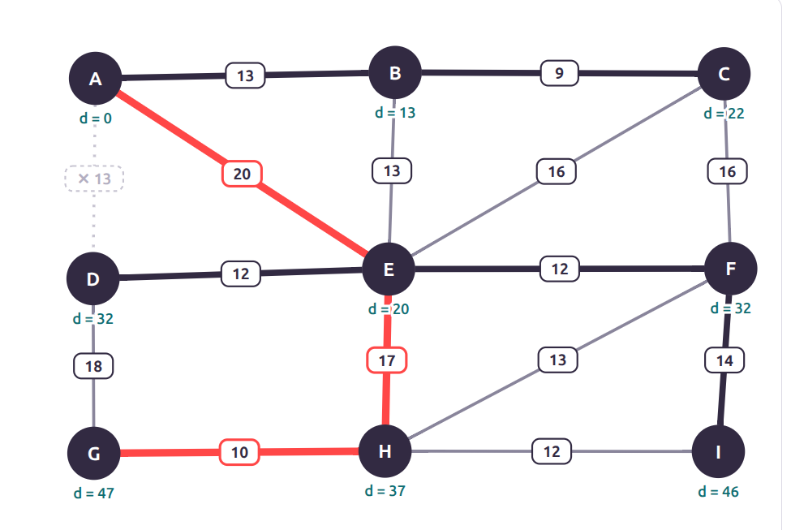
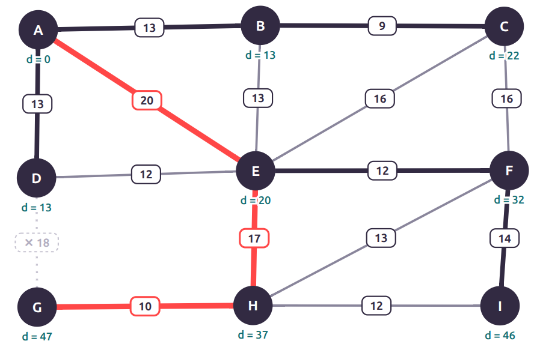
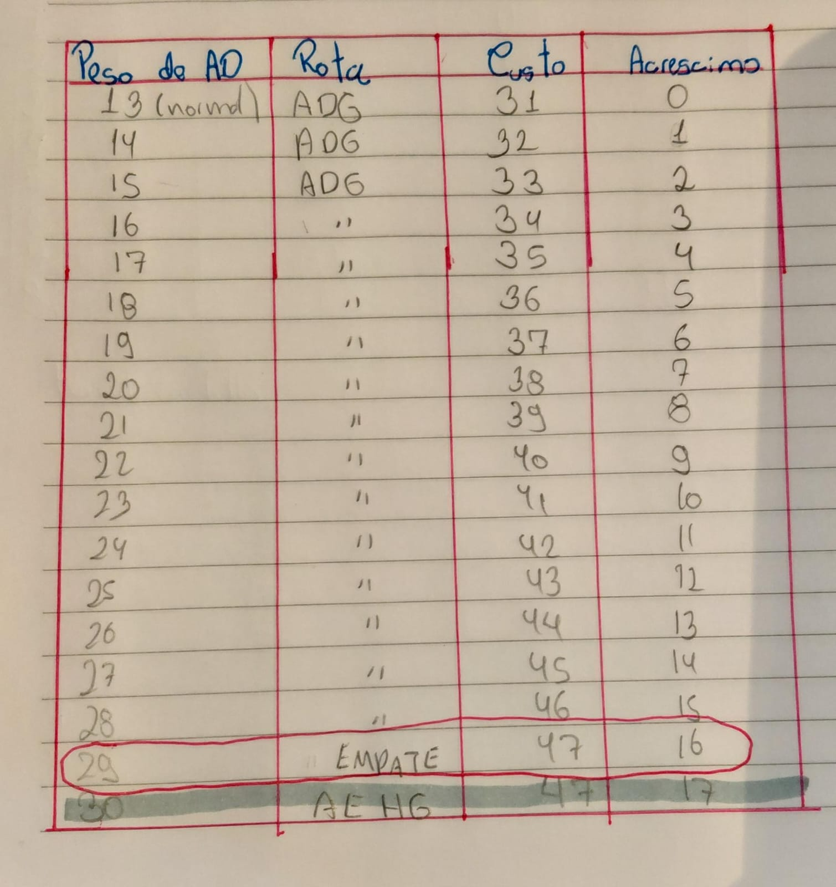
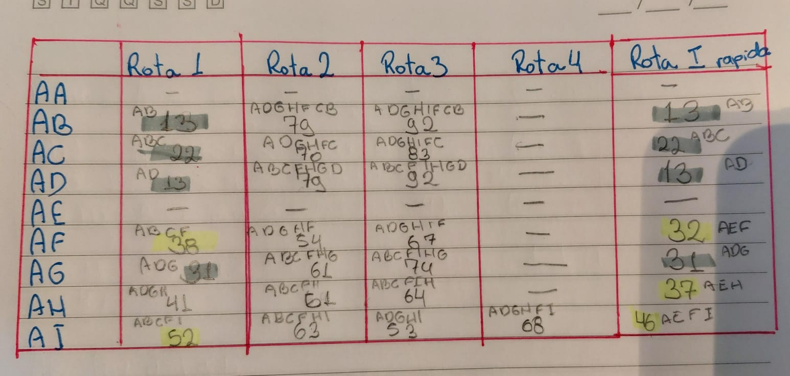

# Atividade Ponderada Smart Grid
Iniciei dando uma olhada geral nas atividades a serem feitas
## Etapa 1 — Modelagem formal e montagem da rede no simulador (2,0 pts)

1) **Tabela de pesos do RA (manuscrita):** apresente D1 a D6, o destino e os 15 pesos, mostrando a conta de cada um como na coluna de exemplo.

Realizei esse passo no papel:

2) **Diagrama topológico (manuscrito):** desenhe o grafo com os 9 vértices e as 15 arestas rotuladas com seus pesos.

3) **Matriz de pesos 9×9 (manuscrita):** indexada de A a I, simétrica (M[i][j] = M[j][i]), com — nos pares sem conexão direta e na diagonal.

Fiz também esses dois passos (2 e 3) no papel, mas acabei colocando eles na mesma folha...:\

4) **Montagem no simulador:** monte a rede e anexe o print com o desenho e a Matriz de pesos do simulador. Confira célula a célula com a sua matriz manuscrita e registre qualquer correção que tenha sido necessária, em qualquer um dos lados. 

Elas estão iguais :-)

5) **Perguntas curtas:**
* **(a) Quantas células — existem fora da diagonal principal? Por que esse número não depende do RA?**
Contando deram 21 de cada lado (são simetricas contei um lado só) 21*2 = 42. Pois o RA por enquanto serviu para contar apenas os pesose não as conexões, os - se referem a conexões que não existem depende de quais vertices estão corelacionados e da quantidade de vertices também

* **(b) Qual é o grau de cada subestação? Confirme que a soma dos graus é igual a 2|E|.**
A:3, B:3, C:3, D:3, E:6, F:4, G:2, H:4, I:2 (fiz contando a quantidade de numero na linha da matriz). 3+3+3+3+6+4+2+4+2 = 30 e 2*15 = 30 então está confirmado!

* **(c) Qual subestação tem o maior grau e o que isso indica sobre o risco operacional da rede?** A subcestação E tem maior grau com 6, não sei se entendi a segunda parte da pergunta, mas já que muitas estações estão conectadas a ela em caso de mais de uma estação falhar é possivel que muitas equipes tenham que passar pelo mesmo ponto (sinceramente não sei se entendi o que é o risco)

## Etapa 2 — Dijkstra: teste de mesa manual e confronto com o simulador (3,0 pts)

1) **Teste de mesa manuscrito:** registre, a cada iteração, o vértice fechado u, L[u], as distâncias L[v] 
de todos os vértices e os antecessores atualizados, até fechar o destino. Valores entre colchetes indicam vértices já fechados.

Realizado no papel:

Obs: na linha 2 também podeia ser D (invertido B com D) mas ia ficar muito fora da ordem alfabetica

2) **Execução no simulador:** rode o Dijkstra passo a passo com origem A e o seu destino. Anexe dois prints: (i) o momento em que o terceiro vértice é fixado; (ii) o estado final, com a tabela “Estado dos vértices” e o caminho até o destino 

**Primeiro a (i) o momento em que o terceiro vértice é fixado:**

No simulador o D ainda não foi calculado na interação, no meu caso eu calculei antes pq a tabela pedia como o exemplo

**(ii) o estado final:**

o simulador não parou no G, ele continuou até fechar todos os vértices, eu parei quando chegou a fechar o G

No final ambos ficam A -> D -> G

3) *Registro das relaxações:* escolha a iteração k = (D4 mod 3) + 3. Para cada vizinho xaminado nessa iteração, escreva a conta dist[u] + W[u][v], compare com dist[v] e diga se houve relaxação ou se o valor foi mantido. Explique, com base na linha 6 do pseudocódigo do simulador, por que os vizinhos já fixos não são examinados. Se o destino for fechado antes da iteração k, continue a execução até ela. 

* k = (D4mod3) + 3 = (2mod3) + 3 = 2 + 3 = **5**
* Linha 5 é de C fechado em 22
* C tem ligações com: B, E e F --> B e E já foram (13 e 20 vindos do A)
* "dist[u] + W[u][v], compare com dist[v]" --> Tive que pesquisar o que era W pq não entendi, mas era a conta mesma da tabela :-|
* F: dist[C] + W[C][F] = 22 + 16 = 38 que é o valor até agora do C mais o caminho de C a F
* Ai pegamos o Caminho anterior que era A -20-> E -12-> F que deu 32 
* Para chegar a F 38 > 32 ai mantem o 32 vindo de E e não de C pois fica menor o valor
* Linha 6 do Pseudo Código: 

`para cada v com W[u][v] ≠ NULO e não fixo:` --> para cada valor até agora do C mais o caminho de C a F não nulo e não fixo (verdadero) faça o seguinte:

`se dist[u] + W[u][v] < dist[v]:     ▸ relaxa` --> Se os caminhs calculados até aqui são maiores que esse então relaxa o caminho antigo e guarda o novo

Sempre guarda a menor soma

4) **Confronto mesa × simulador:** compare a ordem de fechamento, os valores de L e os 
antecessores. Se houver divergência, indique a iteração em que ela surgiu e a causa (erro de soma, desempate, relaxação esquecida ou relaxação indevida).

Feito parte no caderno:

Acho que não houve erro, tem a diferença que eu não continuei até o final e parei no G (calculado o H mas não fechado) e I nem calculado foi.

Não houve divergencia na ordem mas poderia na B para a C

## Etapa 3 — Contingência com o modo Falha (2,5 pts)
1) **Questão 1 — Rota e custo ótimo.** Qual é a distância total mínima (em km) e a sequência exata de subestações de A até o seu destino? Continue o Dijkstra até fechar todos os vértices e liste a ordem cronológica completa de fechame

A ordem com os valores tem na tabela do ultimo exercício.

A distancia fica: A -13-> D -18-> G  = 31

2) **Questão 2 — Varredura de falhas na rota.** Derrube, um de cada vez, cada ramal que pertence à sua rota ótima. Para cada caso, registre em uma tabela: o ramal em falha, a nova rota, o novo custo, o acréscimo em km e o acréscimo percentual. Indique o(s) ramal(is) crítico(s), isto é, cuja falha causa o maior acréscimo. Se dois ramais produzirem o mesmo desvio, explique por quê. Anexe o print da falha do ramal crítico.

Fiz no simulador, e anotei na tabela

Todos os ramais do meu trajeto com falha resultam no mesmo acrecimo, então ou todos são criticos ou nenhum é,  isso não sei dizer, mas diria que todos são pois +50% de km é bastante.

Esse caminho é escolhido por ser o de menor custo disconsiderando os ramais que não funcionam é como se não existissem.

 ai ficaria assim cada tentativa:

**Sem AD :**

A pode ir a B e a E, B parece menor mas para ir para E fica maior ABE = 13 +13 =26 > AE 20
E pode ir para B (já passou), D, F ou H, indo para F teriamos que voltar para H indo para D seria 20 + 12+ 18 = 50 > 20 + 17 + 10 = 47

(Talvez tenha ficado confuso ...)

**Sem DG:**

Se seguissimos o caminho inicial: Poderiamos fazer ADEHG com 52 ou ADEFIHG com 73 entre outras combinações todas maiores que os 47 

Em resumo é a menor rota.

3) **Questão 3 — Folga do primeiro ramal.** Sem usar o modo Falha, aumente progressivamente o peso do 
primeiro ramal da sua rota ótima (clique na pílula do peso ou na célula da matriz). Encontre o maior 
acréscimo inteiro Δ para o qual o custo mínimo de A até o destino não muda. Anexe os prints com peso 
w + Δ e w + Δ + 1. Compare Δ com o acréscimo obtido para esse mesmo ramal na Questão 2 e explique 
a relação entre os dois números. 

Achei um pouco confuso, então não sei se está correto...

Fiz uma tabela para facilitar:

Como sabemos baseado no exercicio anterior a segunda rota mais rapida seria de 47 km, então paraa rota atual de 31km não ser a escolhida com certeza ela pode ter no maximo 28 pois ai a rota fica com 46, com 29 empata (mas o simulador continua escolhendo ela) e com 30 a rota melhor passa ser a de 47 AEHG

Ou seja quando a soma ADG passa a ser maior que AEHG a AEHG será a escolhida.

4) **Questão 4 — Interdição da subestação E.** Simule a perda da subestação E colocando em falha todos 
os ramais incidentes a ela. Monte uma tabela com a distância de A a cada subestação antes e depois da 
interdição e indique quais pioram e em quanto. Sua rota até o destino mudou? Explique por que a perda 
de um vértice de grau alto pode afetar muito ou quase nada uma rota específica.

Fiz uma tabela onde calculei na mão as rotas possiveis sem E e Usei o simulador para a rota ótima com E:

AF piorou em 6km, AH piorou em 4km e AI piorou em 6km

A minha rota até o destino não mudou.

Quando um grau é alto, muitas rotas podem passar por ele, pois tem muitas conexões, quando ele é desativado essas rotas não existem mais, no caso do exeplo é uma rota central então sempre é obrigado a ir pelas laterais, algumas vezes dando volta ao envez de passar pelo meio.

## Etapa 4 — Prim × Dijkstra (2,5 pts) 
Professor acabei não tendo tempo de estudar arvore primária, por isso esse proximo exercicio vai ser feito na lógica e na fé (prometo que vou estudar Prim)

1) **Questão 1 — Teste de mesa de Prim.** Execute o Prim à mão a partir de A, registrando em cada passo o vértice que entra na árvore, a aresta pela qual ele entra e o valor da chave. A regra de desempate é a mesma do Dijkstra. Calcule o custo total da Árvore Geradora Mínima e confirme no simulador (print do estado final do Prim). 

Não sei fazer :-(

2) **Questão 2 — Comparação das árvores.** Usando o quadro de comparação do simulador, transcreva as arestas e o custo da árvore de Prim e da árvore de caminhos mínimos de Dijkstra. Liste as subestações cuja distância a partir de A, seguindo a árvore de Prim, é maior que a distância mínima. Compare o custo da MST com a soma das distâncias de Dijkstra e explique por que a união das rotas radiais a partir de A não gera a MST. 
Não sei fazer :-(

3) **Questão 3 — Troca de raiz.** Repita Prim e Dijkstra usando o seu destino como raiz e origem. O custo da MST mudou? As arestas mudaram? E a árvore de caminhos mínimos? Justifique pela definição de cada problema.

A comparação depende da tarefa anterior. 

4) **Questão 4 — Decisão de engenharia.** Em até 15 linhas, responda: qual das duas árvores você usaria (a) como projeto de uma nova rede com o menor comprimento total de cabos e (b) como plano de despacho das equipes de emergência? Considere também os resultados da Etapa 3: o que acontece com cada árvore se um único ramal dela falhar, e o que isso diz sobre construir apenas a MST? 

A comparação depende da tarefa anterior também ...